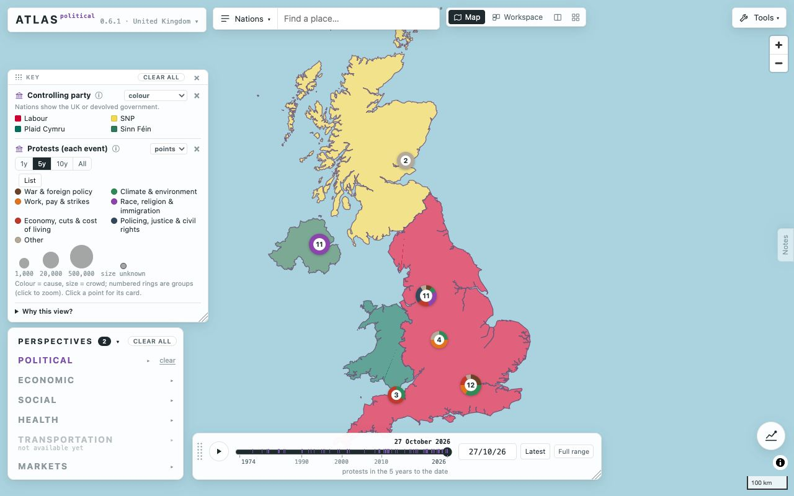
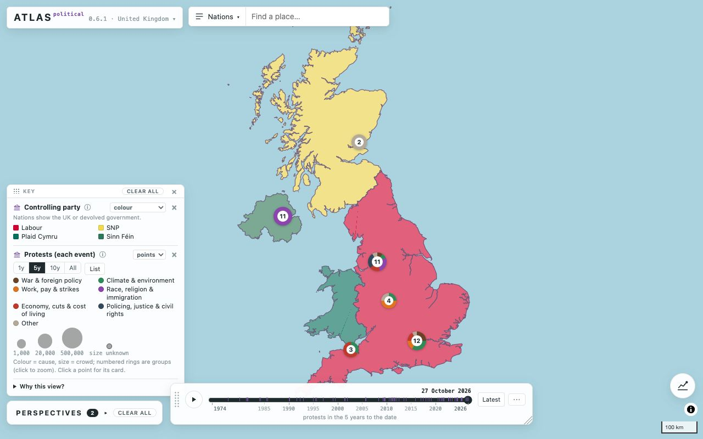

# Decluttering the desktop (Atlas 1.8, Phase 6)

## Before: everything permanently on screen (1280 × 800, default view)

| # | Element | Where | Kind |
|---|---|---|---|
| 1 | ATLAS menu (brand) | top left | menu |
| 2 | Areas ▾ | top | menu |
| 3 | Search | top | input |
| 4 | Tabs: Map · Workspace · Split · All tabs | top | buttons (4) |
| 5 | Tools ▾ | top right | button |
| 6 | Zoom + / − | top right | buttons (2) |
| 7 | Key: grip, Clear all, ×, and per metric ⓘ, “show as” menu, × | left | panel (≈9 controls) |
| 8 | Key: “Why this view?” | left | disclosure |
| 9 | Perspectives panel, open, with Clear all and six perspectives | bottom left | panel |
| 10 | Time bar: grip, play, slider, current-date label, date box, 1y/5y/10y, Latest, Full range, resize grip, note | bottom | panel (≈12 controls) |
| 11 | Notes tab | right edge | button |
| 12 | Chart bubble | bottom right | button |
| 13 | Scale bar, credits ⓘ | bottom right | map furniture |

About 40 controls on the first screen, three of them showing the date (the label above the handle, the date box, and the note).

## After

**Always visible:** ATLAS menu, Areas, search, the Perspectives panel (folded), the time bar, the key (only when something is mapped), the chart bubble, and the compare button (only when places are selected). Scale bar and credits stay (they're required).

## Everything moved, so nothing is lost

| Was | Now |
|---|---|
| **Tools ▾** button (top right) | ATLAS menu → **Tools…** (opens the same panel: measure, lasso, copy or capture the map, grid lines, sliders, panels, hover cards, estimated values) |
| **Notes** tab (right edge) | ATLAS menu → **Notes**, and the tab appears when the pointer nears the right edge (hot zone) |
| **Zoom + / −** | appear when the pointer nears the right edge (hot zone); scroll and pinch still zoom |
| **Tabs bar** (Map · Workspace · Split · All tabs) | shown only when there is something besides the map: workspace items, a chart, table or help tab, or split view. Otherwise ATLAS menu → **Workspace** |
| Time bar **date box** | click the date above the handle to type a date (the box appears; Enter or Esc) |
| Time bar **1y / 5y / 10y** (play step) and **Full range** | the time bar's **⋯** menu |
| Perspectives panel open on load | starts folded; click its heading to open (it still folds by itself after 15 s untouched) |
| Long notes in the key (e.g. protests) | one line, with ⓘ for the rest (Phase 5) |
| Per-perspective Clear in each metric menu | a small “clear” link on the perspective's own row, only when it has something ticked (Phase 2) |

## Duplicates removed
- The current date was shown three ways; now the label above the handle is the one place (click it to type).
- Tools had a top-right button and nothing else; it now lives in the ATLAS menu with Workspace and Notes, so all “extra” views are in one place.
- Clear all stays in two places on purpose (the top of Perspectives and the key), as asked; both use the same function.

## Choices to check
- **Hot zones.** The 1.4 edge hot zones now apply by default to the secondary controls (notes, zoom) at the right edge. The core panels (Perspectives, key, time bar) stay visible, because the brief lists them as always visible. The old option to hide those too is still in Tools → Panels → Near edges.
- **Tabs bar.** Hidden while there's only the map, which also hides “All tabs” and Split: both are in reach again as soon as the workspace has something in it.
